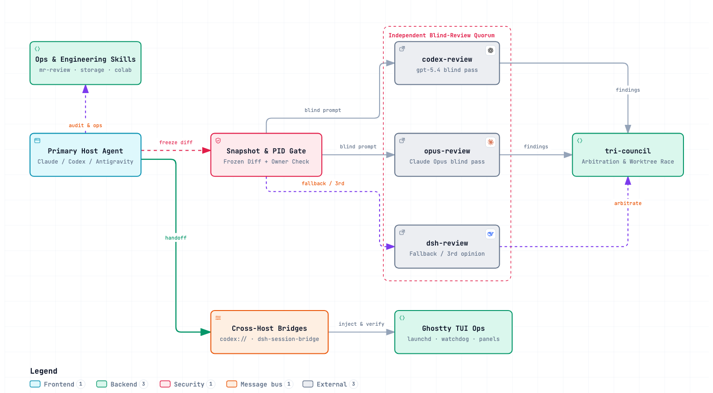

<div align="center">

# agent-ops-skills

**精选 16 个实战打磨的 Agent Skills，覆盖多模型独立盲审、跨宿主编排与终端自动化。**

[](https://github.com/rockcli/agent-ops-skills/actions/workflows/ci.yml)
[](https://github.com/rockcli/agent-ops-skills/releases/tag/v0.1.0)
[](skills)
[](#快速开始)
[](LICENSE)

[English](README.md) | 简体中文

</div>

<p align="center">
  <picture>
    <source media="(prefers-color-scheme: dark)" srcset="docs/architecture-dark.png" />
    <source media="(prefers-color-scheme: light)" srcset="docs/architecture-light.png" />
    
  </picture>
</p>

## 核心特性

- ⚖️ **多模型无偏独立盲审** — 基于冻结的 Git / 工作区快照并行发起 Codex + Claude Opus 双路独立审查（严禁预设主控立场），单方不可用时自动由 DeepSeek Harness（`dsh`）补位，复杂分歧时按需加开第三路。
- 🔁 **跨宿主会话交接与续跑** — 支持将本地 Codex 线程（`codex://threads/<uuid>`）只读提取并移交 Claude Code 接手、跨宿主读写/引导既有 `dsh` 对话，以及向 Ghostty 运行中的 TUI 定时发送消息并回读日志验证落库。
- 🛡️ **工程级安全护栏** — 内置 PID 进程归属核验、只读磁盘扫描与废纸篓可逆清理、显式写权限/授权边界，以及防过度设计评估与独立 worktree 双写赛马流程。
- 🧪 **零外部依赖且带单测** — 脚本全部基于原生 Python 3 / POSIX sh / Node 18 编写，自带 51 个本地单元测试，开箱即用。

## 收录技能

### 多模型独立审查与委派

| 技能 | 简介 | 运行时 / 脚本 |
|------|------|---------------|
| [`codex-review`](skills/codex-review/SKILL.md) | 调用 Codex（支持 `CODEX_REVIEW_MODEL`，默认 `gpt-5.4`）发起冻结快照独立审查、PID 核验与双路协同 | Python 3.12+（`scripts/codex.py` + 14 个单测） |
| [`codex-task`](skills/codex-task/SKILL.md) | 跨宿主委派 Codex 执行只读调查或显式授权的独立 worktree 写任务 | 复用 `codex-review/scripts/codex.py` |
| [`opus-review`](skills/opus-review/SKILL.md) | 调用 Claude Opus（`medium`/`high` 思考强度）发起独立盲审，支持持久化状态机与通知去重 | Python 3.12+（`scripts/opus.py` + 10 个单测） |
| [`opus-task`](skills/opus-task/SKILL.md) | 跨宿主委派 Claude Code / Opus 执行调查或实施任务，严格收敛工具与授权边界 | 复用 `opus-review/scripts/opus.py` |
| [`dsh-review`](skills/dsh-review/SKILL.md) | 调用 DeepSeek Harness（`dsh`）执行独立只读审查，用于双路缺席自动补位或复杂场景第三路盲审 | Python 3.12+（`scripts/dsh.py` + 19 个单测） |
| [`tri-council`](skills/tri-council/SKILL.md) | 三方无偏盲审方案共创、防过度设计砍削体检，以及独立 worktree A/B 双写赛马流程 | 编排 SOP |

### 跨宿主交接与终端自动化

| 技能 | 简介 | 运行时 / 脚本 |
|------|------|---------------|
| [`codex-thread-takeover`](skills/codex-thread-takeover/SKILL.md) | 只读解析本地 Codex CLI/Desktop 对话线程（`codex://threads/<uuid>`），还原完整上下文并移交 Claude Code 继续执行 | Python 3（`scripts/read_thread.py`） |
| [`codex-send-continue`](skills/codex-send-continue/SKILL.md) | 优先用宿主原生工具（或 CLI 兜底）向既有 Codex 任务追加后续指令 | SOP + CLI 参考 |
| [`dsh-session-bridge`](skills/dsh-session-bridge/SKILL.md) | 按标题/别名跨宿主定位、读历史、全文搜索、排队/引导（queue/steer）、代答提问与交接既有 `dsh` 会话 | Node 18+（`scripts/dsh-session.mjs`） |
| [`tui-continue-scheduler`](skills/tui-continue-scheduler/SKILL.md) | 向 Ghostty 中已在运行的交互式 Agent TUI（如 Claude Code）定时注入文本并回读 session 日志确认送达 | POSIX sh + macOS `launchd` + 实证踩坑集 |
| [`ghostty-multi-agent-orchestration`](skills/ghostty-multi-agent-orchestration/SKILL.md) | Ghostty 多 Agent（`claude`/`codex`/`kimi`/`pi`）面板与 headless 编排、防误杀红线及多分支合并推演 | 实战 Playbook |
| [`agent-watchdog-advisor`](skills/agent-watchdog-advisor/SKILL.md) | 对长耗时任务或跨宿主对话进行主动定时盯盘、耗时与信心度预估，以及防卡死高层破局诊断 | 监工 SOP |

### 研发与工程效率

| 技能 | 简介 | 运行时 / 脚本 |
|------|------|---------------|
| [`mr-review-mail`](skills/mr-review-mail/SKILL.md) | GitLab MR 审查与新旧缺陷归因，将具体代码评论与简短可迁移的通用开发原则邮件分离交付 | Python 3（`scripts/send_mail.py` + 8 个单测） |
| [`storage-analyzer`](skills/storage-analyzer/SKILL.md) | macOS / Windows 只读磁盘分析，输出绿/橙/红三级安全清单、交互式 HTML 报告与仅入废纸篓的本地 Web 服务 | Python 3（`scripts/scan.py`、`server.py`） |
| [`web-interaction-design`](skills/web-interaction-design/SKILL.md) | 系统性 Web 交互与视觉重设计流程：尼尔森启发式审计 → CSS Design Tokens → 组件状态 → 截图验收闭环 | 设计 SOP |
| [`colab-operator`](skills/colab-operator/SKILL.md) | 通过 `google-colab-cli` 管理 Google Colab GPU/TPU 会话（`H100`/`A100`/`L4`/`T4`/`v5e1`/`v6e1`）、配额与持久化 Kernel | CLI 使用手册 |

## 快速开始

```bash
git clone https://github.com/rockcli/agent-ops-skills.git
cd agent-ops-skills
./scripts/install.sh
```

`./scripts/install.sh` 默认会将全部 16 个技能以软链接方式安装到 `~/.agents/skills`，**遇到本机已存在的同名目录默认跳过**，不会覆盖你的本地配置。

**按需安装或指定目标目录：**

```bash
# 仅安装指定技能
./scripts/install.sh codex-thread-takeover tui-continue-scheduler web-interaction-design

# 安装到 ~/.claude/skills 或 ~/.codex/skills
./scripts/install.sh --target ~/.claude/skills

# 使用复制而非软链接（如需覆盖已有目录可追加 --force）
./scripts/install.sh --copy
```

## 配置与测试

- **`CODEX_REVIEW_MODEL`** — 覆盖 `codex-review/scripts/codex.py` 的默认 Codex 模型（默认 `gpt-5.4`），也可单次通过 `--model` 指定。
- **`TUI_LAUNCHD_LABEL`** — 覆盖 `tui-continue-scheduler` 的 macOS `launchd` 标签（默认 `com.user.tui-continue-once`）。

```bash
python3 -m unittest discover -s skills/codex-review/scripts/tests -v
python3 -m unittest discover -s skills/opus-review/scripts/tests -v
python3 -m unittest discover -s skills/dsh-review/scripts/tests -v
python3 -m unittest discover -s skills/mr-review-mail/scripts -p 'test_*.py' -v
```

## 致谢与说明

- 所有技能均在本地运行并复用你本机已有的 CLI/工具凭据，无第三方中转服务、无遥测上报。
- `skills/opus-review/scripts/vendor/aris_review.py` 引用自开源项目 [ARIS Claude Review MCP](https://github.com/wanshuiyin/Auto-claude-code-research-in-sleep)（MIT 许可证），详见 [`provenance.md`](skills/opus-review/references/provenance.md) 与 [`vendor/LICENSE`](skills/opus-review/scripts/vendor/LICENSE)。

## 许可证

[MIT](LICENSE) © [rockcli](https://github.com/rockcli)
